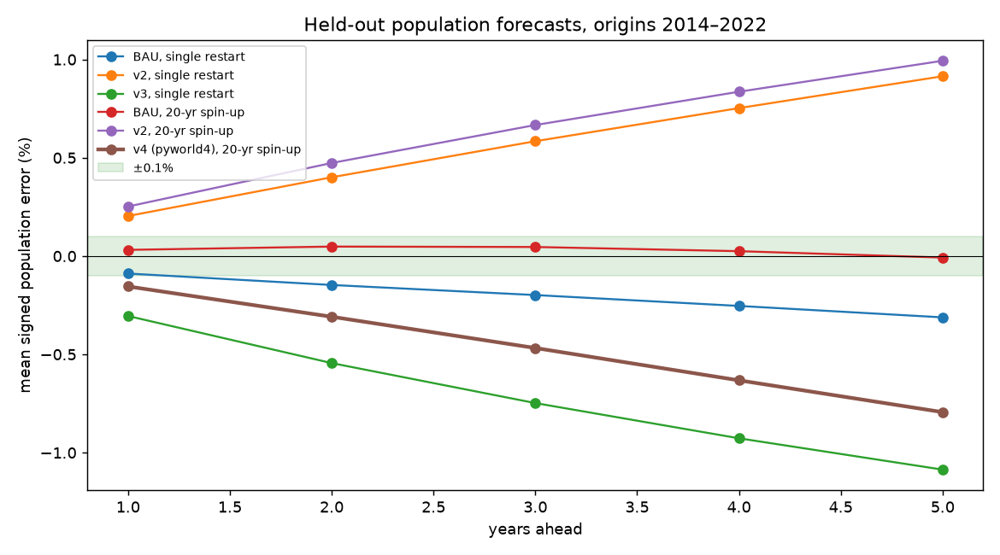
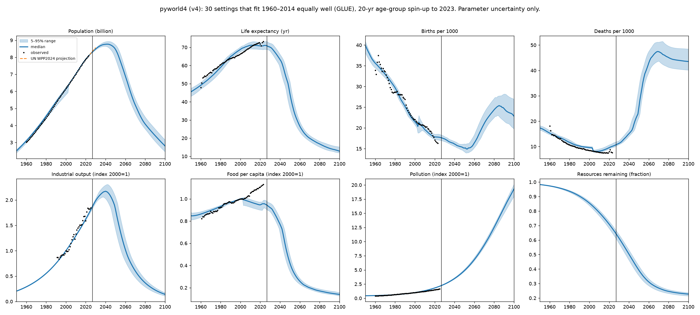
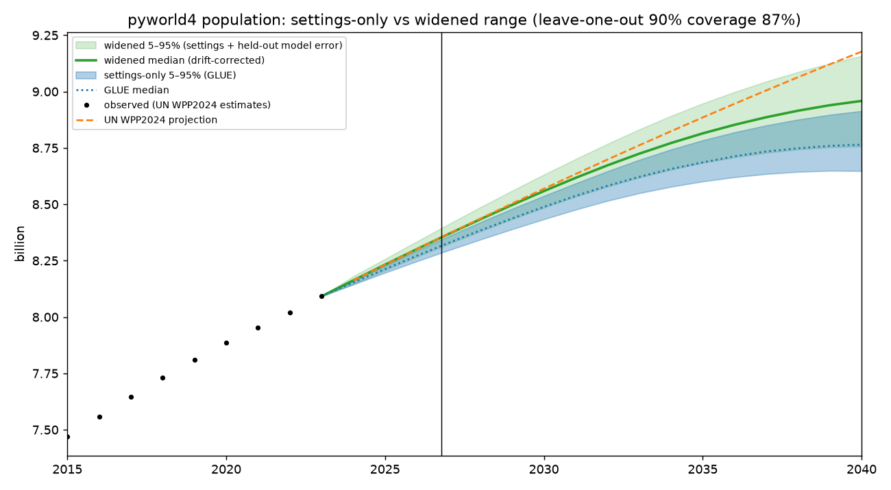
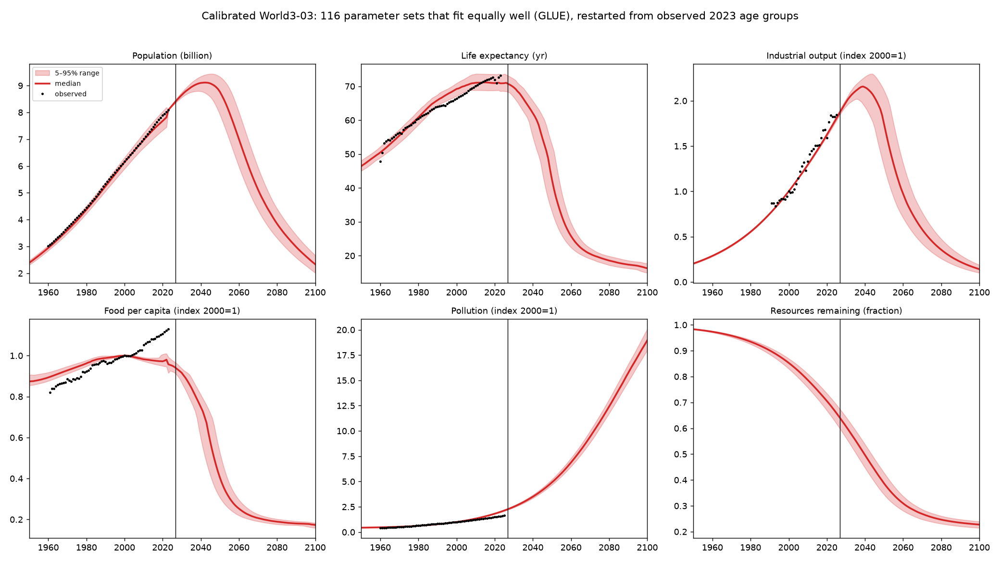
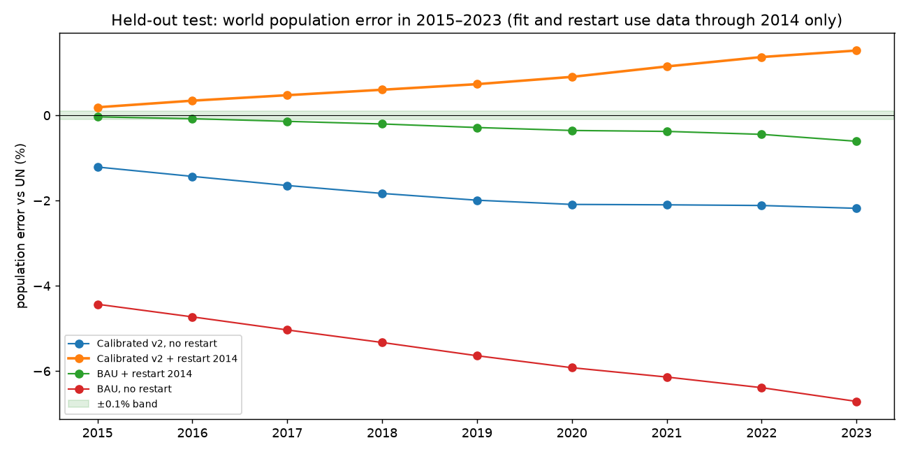
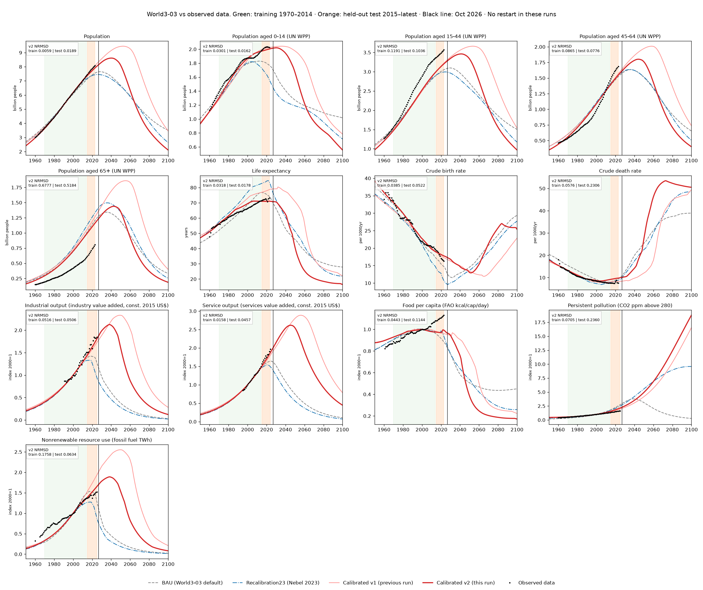
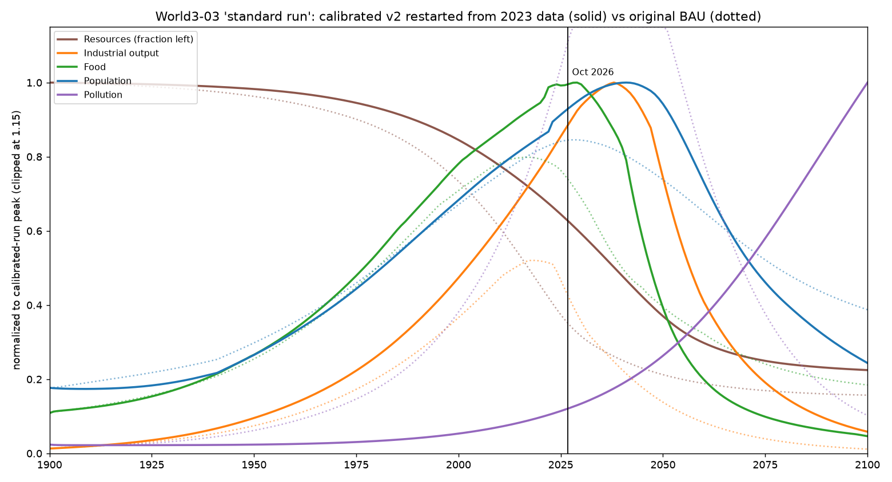

# pyworld4: World3-03 calibrated to observed data (through 2023–2025)

**pyworld4** = the original World3-03 engine (PyWorld3-03, source untouched) + v2 settings + re-fitted demographic lookup tables ([tables_v4.json](tables_v4.json), a drop-in for `World3.set_world3_table_functions()`) + a 20-year data spin-up of the four age groups before each forecast. Changes that would need new equations are out of scope (see *Lessons for zigworld*).

_v4 fit: 6344 DE + Powell evaluations, 906s, objective J = OS/OS_ref + R/R_ref + 0.5 C/C_ref, J(v2) = 2.5 → J(v4) = 1.1387. Tuning uses 1960–2014 only; every number marked held-out uses 2015–2023 data never seen in tuning._

## Held-out population forecasts (origins 2014–2022, mean |error| %, signed in brackets)

| Model | 1 yr | 2 yr | 3 yr | 4 yr | 5 yr |
|---|---|---|---|---|---|
| BAU, single restart | 0.089 (-0.089) | 0.147 (-0.147) | 0.198 (-0.198) | 0.254 (-0.254) | 0.312 (-0.312) |
| v2, single restart | 0.204 (+0.204) | 0.401 (+0.401) | 0.584 (+0.584) | 0.753 (+0.753) | 0.915 (+0.915) |
| v3, single restart | 0.305 (-0.305) | 0.544 (-0.544) | 0.748 (-0.748) | 0.927 (-0.927) | 1.086 (-1.086) |
| BAU, 20-yr spin-up | 0.038 (+0.032) | 0.048 (+0.048) | 0.046 (+0.046) | 0.033 (+0.025) | 0.023 (-0.008) |
| v2, 20-yr spin-up | 0.252 (+0.252) | 0.473 (+0.473) | 0.667 (+0.667) | 0.836 (+0.836) | 0.993 (+0.993) |
| **v4 (pyworld4), 20-yr spin-up** | 0.155 (-0.155) | 0.309 (-0.309) | 0.468 (-0.468) | 0.632 (-0.632) | 0.794 (-0.794) |

> **BAU looks best on population only, for the wrong reasons.** Its simulated economy collapses after ~2020: life expectancy 70 → 62 by 2030 (observed ≈ 73), and its rising death rate coincided with COVID. A population-only score can be fooled, so birth rate, death rate and life expectancy are scored too.

## Held-out demographic rates and overall fit (2015–2023)

| | BAU | v2 | **v4** |
|---|---|---|---|
| birth rate NRMSD | 0.0369 | 0.1259 | 0.0500 |
| death rate NRMSD | 0.1359 | 0.0859 | 0.2246 |
| life expectancy NRMSD | 0.0242 | 0.0185 | 0.0188 |
| all 13 curves, test NRMSD (no restart) | 0.1632 | 0.1010 | 0.1033 |
| life expectancy 2023 → 2030 | 70.0 → 61.9 | 71.0 → 69.4 | 71.0 → 70.2 |
| 2026 population vs UN projection | -0.55% | +0.74% | -0.35% |
| 2026 age 65+ vs UN projection | +5.95% | +6.50% | +0.26% |

### v4 table adjustments

Smooth warps only (scale and tilt), to limit overfitting: `M1..M4`: y·exp(a + b·(LE−70)/10); `SFSN`: y·exp(a + b·(DIOPC−400)/400); `FCE_TOCLIP`: 1−y' = (1−y)·exp(a).

| number | value | bounds |
|---|---|---|
| `m1_a` | -0.5694 | [-0.7, 0.7] |
| `m2_a` | -0.4943 | [-0.7, 0.7] |
| `m3_a` | 0.3880 | [-0.7, 0.7] |
| `m4_a` | 0.3798 | [-0.7, 0.7] |
| `m1_b` | -0.1217 | [-0.7, 0.7] |
| `m2_b` | 0.0975 | [-0.7, 0.7] |
| `m3_b` | 0.0098 | [-0.7, 0.7] |
| `m4_b` | -0.0604 | [-0.7, 0.7] |
| `sfsn_a` | -0.0545 | [-0.5, 0.5] |
| `sfsn_b` | 0.3575 | [-0.5, 0.5] |
| `fce_a` | 0.8795 | [-1.5, 1.5] |
| `dcfsn` | 4.4459 | [2, 6] |
| `mtfn` | 8.8260 | [6, 14] |

### What still limits accuracy: built into the equations

World3 moves people between its 4 age groups at fixed yearly fractions (1/15, 1/30, 1/20), as if each group were spread evenly by age. Baby boomers break this, so the 65+ group grows ≈1%/yr too fast in one-step checks. The fit compensates by raising old-age mortality (`m3_a`, `m4_a` ≈ +0.38, i.e. ≈ +46%), which pushes the death rate up as the population ages and causes the remaining negative population drift. Fixing it needs new equations → zigworld.

## Range of outcomes (GLUE (Beven & Binley 1992) around pyworld4 v4)

_accepted 11/1501 sets with J <= 1.2526 (best 1.1387 x 1.10; v4 optimum J=1.1387) -> FEWER THAN 30; using the 30 best (worst kept 1.3101); 25 numbers sampled (v4's 13 + v2's 12 economy settings), span 0.05._

| 2026 | 5% | median | 95% |
|---|---|---|---|
| Population (B) | 8.2469 | 8.2715 | 8.2936 |
| 0–14 (B) | 2.0327 | 2.0471 | 2.0623 |
| 15–44 (B) | 3.6080 | 3.6097 | 3.6109 |
| 45–64 (B) | 1.7259 | 1.7319 | 1.7360 |
| 65+ (B) | 0.8641 | 0.8841 | 0.8960 |
| Life expectancy (yr) | 68.8 | 71.0 | 73.2 |
| Birth rate | 16.98 | 17.67 | 18.36 |
| Death rate | 9.96 | 10.53 | 11.73 |

| Peak year | 5% | median | 95% |
|---|---|---|---|
| `pop` | 2038 | 2042 | 2043 |
| `io` | 2036 | 2040 | 2042 |
| `f` | 2026 | 2030 | 2032 |
| `ppolx` | 2100 | 2100 | 2100 |

Peak population 8.65 / 8.77 / 8.93 B (5/50/95%).

> **After ~2040 these are not forecasts.** v2's economy contains a food-system collapse (modelled food per capita falls while observed keeps rising), and the warped tables are pushed far outside the life-expectancy range seen in 1960–2014. Treat the long-run tail as World3's overshoot-and-collapse scenario.

## Widened range: settings + the model's own held-out error

Held-out drift of v4 (origins 2014–2022, 20-yr spin-up): mean **-0.119%/yr**, spread 0.042%/yr between origins, noise 0.095% (n = 9, Student-t). Leave-one-origin-out check: **39/45** held-out errors inside the predicted 90% range (87%).

| Year | settings only 5/50/95 (B) | **widened 5/50/95 (B)** | UN WPP2024 projection (B) | UN inside widened? |
|---|---|---|---|---|
| 2024 | 8.144 / 8.153 / 8.160 | **8.145 / 8.162 / 8.180** | 8.162 | yes |
| 2025 | 8.196 / 8.213 / 8.228 | **8.207 / 8.232 / 8.257** | 8.232 | yes |
| 2026 | 8.247 / 8.272 / 8.294 | **8.267 / 8.301 / 8.335** | 8.301 | yes |
| 2027 | 8.296 / 8.329 / 8.358 | **8.324 / 8.368 / 8.412** | 8.369 | yes |
| 2028 | 8.343 / 8.384 / 8.420 | **8.380 / 8.434 / 8.487** | 8.437 | yes |
| 2030 | 8.434 / 8.489 / 8.537 | **8.485 / 8.559 / 8.631** | 8.569 | yes |
| 2035 | 8.601 / 8.686 / 8.784 | **8.684 / 8.815 / 8.947** | 8.885 | yes |
| 2040 | 8.648 / 8.765 / 8.914 | **8.757 / 8.959 / 9.158** | 9.177 | **no** |

> Close agreement with the UN projection is **two models agreeing**, not verified accuracy: both extend recent trends, and UN numbers after 2023 are projections. The real check is the next UN estimates (WPP 2026). The longest tested horizon is 9 years, so years after ~2032 are extrapolation.

## v3 (negative result, kept for the record)

Tuning the 14 scalar settings for 5-year forecasts from 1995/2002/2009 improved the training score (J 2.000 → 1.663) but made held-out forecasts worse (table above) and the whole-curve test score worse (0.1010 → 0.1268). Errors keep the same sign every year: a growth-rate bias that scalar settings only flip. This motivated the table re-fit.

## Lessons for zigworld

1. **Single-year age groups** (0–100+, both sexes) instead of 4 buckets: removes the ageing error and the compensating over-mortality.
2. **Fit to age-specific rates** (UN WPP fertility and mortality by age), not only totals.
3. **Data spin-up / assimilation as a built-in feature**, not a runtime patch.
4. **Multi-measure scoring** (population + birth/death rates + life expectancy + economy): a single number was fooled by BAU.
5. **Speed**: ≈0.3 s per Python run limits searches (up to 17k runs here) and ensembles.

---

# Earlier version (v2): + UN age structure, restart from data, range of outcomes

_Generated 2026-10-09T22:52:25-0700 · model: PyWorld3-03 @ `1f1b2f40` · data manifest sha256 `ee7c726dc1a4` · optimizer nfev=16912, 150 generations, 981s_

## Fit quality (weighted NRMSD over all targets, lower is better)

| Scenario | Train 1970–2014 | **Test 2015–latest (held out)** |
|---|---|---|
| BAU (World3-03 default) | 0.1089 | **0.1632** |
| Recalibration23 (Nebel 2023) | 0.1092 | **0.2032** |
| Calibrated v1 (previous run) | 0.0856 | **0.1030** |
| Calibrated v2 (this run) | 0.0784 | **0.1010** |
| Calibrated v2 + restart at 2014 (observed age groups) | 0.0775 | **0.0713** |
| BAU + restart at 2014 (observed age groups) | 0.1079 | **0.1234** |

The *restart at 2014* rows swap in the observed age groups at the end of training, so 2015–latest is still unseen.

## Population: held-out error by year (%)

| Year | UN observed | Calibrated v2, no restart | Calibrated v2 + restart 2014 | BAU + restart 2014 | BAU, no restart |
|---|---|---|---|---|---|
| 2015 | 7.4705 B | -1.213% | +0.189% | -0.035% | -4.432% |
| 2016 | 7.5586 B | -1.432% | +0.344% | -0.079% | -4.728% |
| 2017 | 7.6456 B | -1.646% | +0.473% | -0.141% | -5.035% |
| 2018 | 7.7299 B | -1.832% | +0.601% | -0.202% | -5.329% |
| 2019 | 7.8113 B | -1.991% | +0.732% | -0.285% | -5.640% |
| 2020 | 7.8870 B | -2.090% | +0.903% | -0.355% | -5.921% |
| 2021 | 7.9544 B | -2.099% | +1.147% | -0.376% | -6.140% |
| 2022 | 8.0214 B | -2.115% | +1.368% | -0.446% | -6.389% |
| 2023 | 8.0917 B | -2.181% | +1.521% | -0.608% | -6.711% |

| Summary | Calibrated v2, no restart | Calibrated v2 + restart 2014 | BAU + restart 2014 | BAU, no restart |
|---|---|---|---|---|
| max abs. error | 2.181% | 1.521% | 0.608% | 6.711% |
| mean abs. error | 1.844% | 0.809% | 0.281% | 5.592% |

### Per target (test-window NRMSD)

| Target | weight | last obs. | BAU (World3-03 default) | Recalibration23 (Nebel 2023) | Calibrated v1 (previous run) | Calibrated v2 (this run) | Calibrated v2 + restart at 2014 (observed age groups) |
|---|---|---|---|---|---|---|---|
| Population | 1.0 | 2023 | 0.0568 | 0.0616 | 0.0025 | 0.0189 | 0.0094 |
| Population aged 0-14 (UN WPP) | 0.25 | 2023 | 0.1089 | 0.1860 | 0.0061 | 0.0162 | 0.0152 |
| Population aged 15-44 (UN WPP) | 0.25 | 2023 | 0.1393 | 0.1465 | 0.1018 | 0.1036 | 0.0116 |
| Population aged 45-64 (UN WPP) | 0.25 | 2023 | 0.0891 | 0.0706 | 0.0682 | 0.0776 | 0.0099 |
| Population aged 65+ (UN WPP) | 0.25 | 2023 | 0.5678 | 0.7341 | 0.6358 | 0.5184 | 0.1379 |
| Life expectancy | 0.5 | 2023 | 0.0531 | 0.1604 | 0.0782 | 0.0178 | 0.0189 |
| Crude birth rate | 0.5 | 2023 | 0.1081 | 0.2865 | 0.0354 | 0.0522 | 0.0947 |
| Crude death rate | 0.5 | 2023 | 0.1363 | 0.0919 | 0.0759 | 0.2306 | 0.0662 |
| Industrial output (industry value added, const. 2015 US$) | 0.5 | 2025 | 0.2008 | 0.3241 | 0.0795 | 0.0506 | 0.0520 |
| Service output (services value added, const. 2015 US$) | 0.5 | 2024 | 0.1124 | 0.1559 | 0.0734 | 0.0457 | 0.0465 |
| Food per capita (FAO kcal/cap/day) | 0.7 | 2023 | 0.1669 | 0.1238 | 0.1226 | 0.1144 | 0.1367 |
| Persistent pollution (CO2 ppm above 280) | 0.5 | 2025 | 0.5286 | 0.4111 | 0.1413 | 0.2360 | 0.2360 |
| Nonrenewable resource use (fossil fuel TWh) | 0.5 | 2025 | 0.0843 | 0.2247 | 0.2115 | 0.0634 | 0.0726 |

## Parameters

| Param | World3-03 default | Recalibration23 | v1 | **v2** | bounds |
|---|---|---|---|---|---|
| `alic` | 14 | 15.24 | 11.43 | **13.99** | [8, 25] |
| `alsc` | 20 | — | 27.73 | **28.09** | [10, 30] |
| `icor` | 3 | — | 2.707 | **3.026** | [2, 4.5] |
| `pptd` | 20 | 116.4 | 142.9 | **149.5** | [20, 150] |
| `imef` | 0.1 | 0.1102 | 0.07281 | **0.05845** | [0.05, 0.25] |
| `nri` | 1e+12 | 1.302e+12 | 2.582e+12 | **2.511e+12** | [7e+11, 3e+12] |
| `uildt` | 10 | 0.533 | 11.77 | **10.37** | [0.5, 15] |
| `hsid` | 20 | 38.24 | 11.35 | **13.88** | [10, 50] |
| `lpd` | 20 | 33.84 | 37.7 | **28.04** | [10, 50] |
| `mtfn` | 12 | 9.454 | 8.577 | **9.741** | [8, 14] |
| `dcfsn` | 3.8 | — | 4.08 | **4.781** | [2.5, 5] |
| `lfpf` | 0.75 | 1.022 | 0.7416 | **0.7136** | [0.55, 0.9] |
| `len` | 28 | — | — | **23.53** | [20, 40] |
| `sad` | 20 | 13.38 | 13.38 | **10.48** | [5, 30] |

## 2026 figures (calibrated v2, restarted from observed 2023 age groups)

> 2026 hasn't been fully observed yet, so the UN column is the **UN WPP2024 Medium-variant projection**, not an observation.

| Variable | Model 2026 | UN WPP2024 projection 2026 | difference |
|---|---|---|---|
| Total population | 8.3476 B | 8.3007 B | +0.57% |
| 0–14 | 2.0576 B | 1.9993 B | +2.92% |
| 15–44 | 3.6040 B | 3.6550 B | -1.39% |
| 45–64 | 1.7485 B | 1.7662 B | -1.00% |
| 65+ | 0.9374 B | 0.8802 B | +6.50% |

## Range of outcomes (GLUE (Beven & Binley 1992)): 116 equally good parameter sets

_accepted 116/1501 sets with train NRMSD <= 0.0862 (best 0.0784 * 1.10)_

| Variable (2026) | 5% | median | 95% |
|---|---|---|---|
| Population (B) | 8.2973 | 8.3434 | 8.4019 |
| Life expectancy (yr) | 68.4 | 71.0 | 73.4 |
| Birth rate | 16.82 | 18.04 | 19.85 |
| Death rate | 7.55 | 8.12 | 8.96 |

| Peak year | 5% | median | 95% |
|---|---|---|---|
| `pop` | 2039 | 2042 | 2046 |
| `io` | 2036 | 2040 | 2043 |
| `f` | 2026 | 2030 | 2033 |
| `ppolx` | 2100 | 2100 | 2100 |

> The range covers **parameter** uncertainty only. Structural error in the model (food per capita, fossil fuel use) isn't included, so the real uncertainty is wider.

